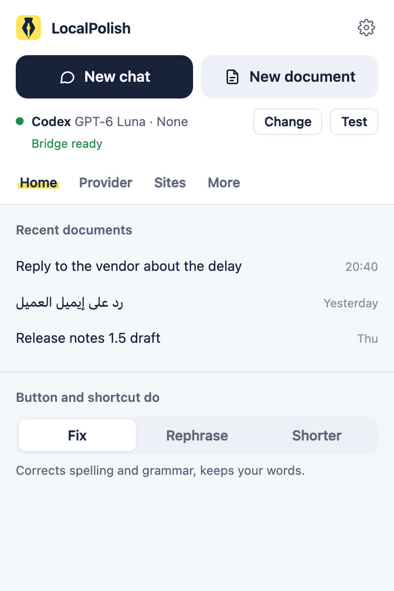
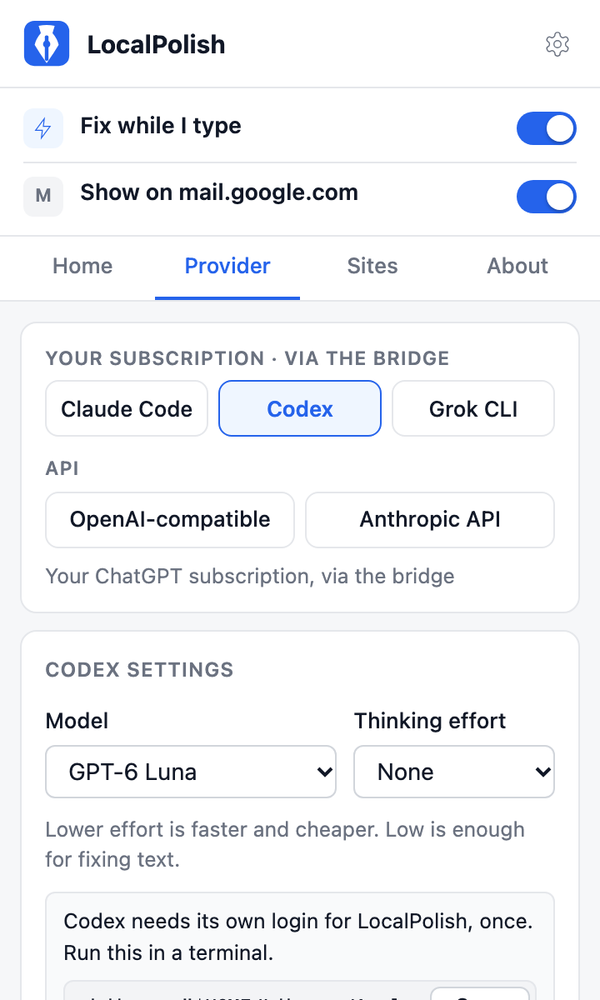
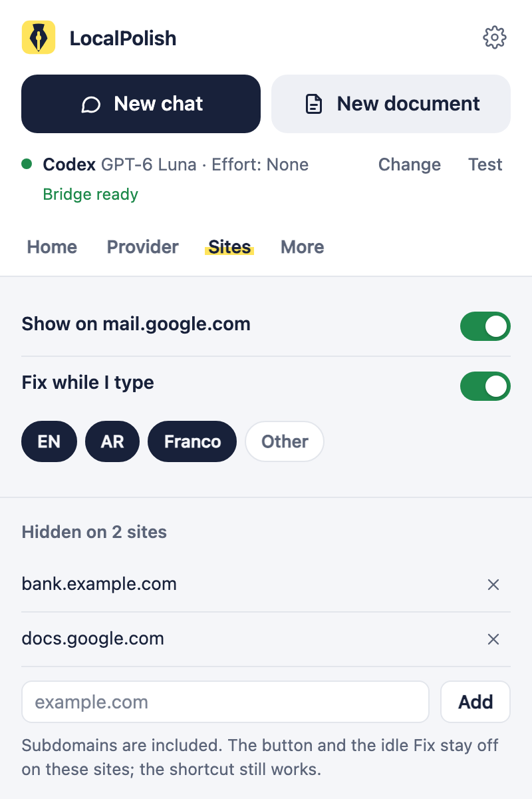
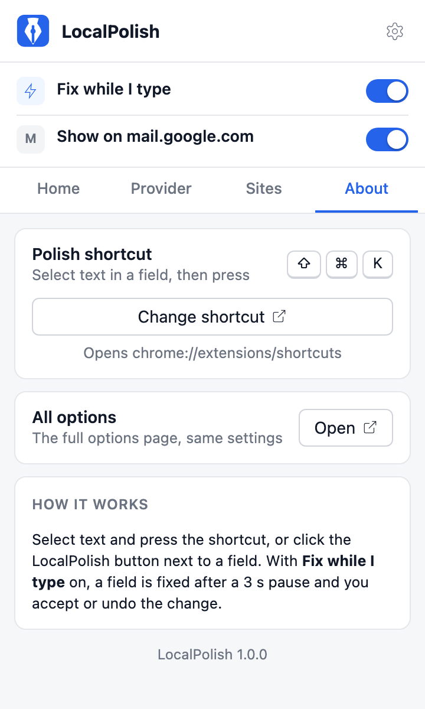
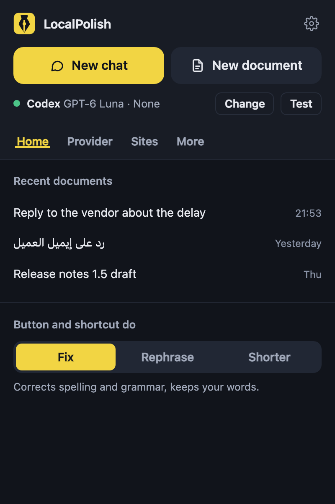

<p align="center">
  
</p>

<h1 align="center">LocalPolish</h1>

<p align="center">
  Fix and rewrite text in any web text field, with the AI subscriptions you already pay for.<br />
  Claude Code, Codex and Grok CLI through a local bridge, or any OpenAI-compatible or Anthropic API.
</p>

<p align="center">
  
  
  
  
</p>

<table align="center">
  <tr>
    <td align="center"><br /><sub>Home</sub></td>
    <td align="center"><br /><sub>Provider</sub></td>
    <td align="center"><br /><sub>Sites</sub></td>
  </tr>
  <tr>
    <td align="center"><br /><sub>About</sub></td>
    <td align="center"><br /><sub>Dark mode</sub></td>
    <td></td>
  </tr>
</table>

<p align="center">The toolbar popup. <code>npm run shots</code> renders these from the built extension.</p>

## What it does

**Rewrite**

- Select text in a text field and click the small round button under your selection, or press
  <kbd>Cmd</kbd>+<kbd>Shift</kbd>+<kbd>K</kbd> (<kbd>Ctrl</kbd>+<kbd>Shift</kbd>+<kbd>K</kbd> off
  macOS). With nothing selected, the shortcut takes the whole focused field.
- A popup next to the field has three tabs: **Fix**, **Rephrase** and **Shorter**. Fix runs when
  it opens. Rephrase waits for a tone: **Keep tone**, **Polite**, **Formal**, **Casual** or
  **Angry but civil**.
- The answer streams in as a word diff: removed words in red, added words in green.
- **Accept** puts the new text in the field, and the site's own Undo brings the old text back.
  **Copy** and **Retry** are next to it. <kbd>Esc</kbd> closes the popup, and
  <kbd>Cmd</kbd>+<kbd>Enter</kbd> or <kbd>Ctrl</kbd>+<kbd>Enter</kbd> accepts.
- **Shorter** counts characters and warns when the result is over 280.
- A warning lists any link, @mention, #hashtag, code or emoji the rewrite dropped, or says when
  Arabic script came back in another script.
- When a site ignores the new text, the popup copies it and asks you to paste.

**Fix while I type**

- On by default. When you stop typing for 3 seconds in a message box or rich editor, a Fix runs in
  the background and a small marker counts the fixes. Click it to see the diff, then accept or
  leave it.
- It skips single-line inputs, search boxes, code editors, fields with spellcheck off, and text
  under four words.

**Toolbar popup**

- Every setting in one place, with the pen nib icon. Two switches sit on top: **Fix while I
  type**, and **Show on** the site you are on.
- **Home**: the provider in use with its model and effort, a status pill, **Test connection**,
  and the default mode (Fix, Rephrase or Shorter).
- **Provider**: pick Claude Code, Codex or Grok CLI (your subscription, through the bridge), or
  the OpenAI-compatible or Anthropic API. Model and thinking effort are presets plus **Custom**.
  The bridge card lists each CLI's version.
- **Sites**: the sites where the button and Fix while I type stay off, with an Add field and a
  one-click **Hide on** for this tab. Subdomains are included. The shortcut still works there.
- **About**: the shortcut, a button to change it, and a link to the full options page.
- Hold the pointer on a label for 2 seconds to see what it does. Light and dark follow your
  system.

**Providers**

- Claude Code, Codex and Grok CLI run on this computer through a native-messaging bridge, with
  their tools turned off. Grok can still search X and keeps its session history in `~/.grok`.
- Any OpenAI-compatible server (OpenAI, xAI, OpenRouter, LM Studio, Ollama), with an optional
  key, and the Anthropic API with a key.

## Install

You need macOS or Windows and Google Chrome. For a CLI provider you also need Node.js 22 or newer
and a logged-in `claude`, `codex` or `grok` CLI. An API provider needs only a key, or a local
server.

**From the release:**

1. Download `localpolish-1.1.0.zip` from the
   [latest release](https://github.com/ashahinL/localpolish/releases/latest) and extract it.
2. Open `chrome://extensions`, turn on **Developer mode**, click **Load unpacked**, and pick the
   extracted folder.
3. For a CLI provider, clone this repo and install the bridge (see Set up the bridge, below). The bridge needs
   only Node, so `npm install` is not required for it.

The extension ID is fixed (`ealpmjmaclnlpelpcacmbicmdipmbeei`), so the release and a build from
source both work with the same bridge.

**From source,** which can be newer than the release:

1. Clone the repo and enter the folder.

```bash
git clone git@github.com:ashahinL/localpolish.git
```

```bash
cd localpolish
```

2. Install the dependencies.

```bash
npm install
```

3. Build the extension. The built files are in `dist/`.

```bash
npm run build
```

4. Open `chrome://extensions`. Turn on **Developer mode**. Click **Load unpacked**, then pick the `dist/` folder.

### First-run setup

On a new install, LocalPolish opens a setup page in a new tab. An update does not open it. It has three short steps:

1. **Pick a provider.** The same picker and forms as the toolbar popup. For a CLI provider it also shows the bridge, with the install command when the bridge is missing.
2. **Test it.** **Test connection** sends a fixed sample, never your own text.
3. **Fix while I type.** It is on. One line says where your text goes for the provider you picked. Turn it off here if you only want the button and the shortcut.

Press **Done** to close the tab. You can change all of this later in the toolbar popup. Until the bridge is installed, Fix while I type shows no error markers. The button and the shortcut still show the error.

### Set up the bridge

Only the CLI providers need it.

1. Install the bridge. The command prints which CLIs it found.

```bash
npm run bridge:install
```

On Windows, run it in your own terminal, not from an app's built-in agent such as the Claude desktop app. Those apps can keep their registry writes private, so Chrome would not find the bridge.

2. Log in to each CLI you want to use. Do this once, in a terminal.

For Claude Code, run `claude` and log in.

```bash
claude
```

To log in without opening the Claude prompt, run this instead.

```bash
claude auth login
```

For Grok CLI, run this.

```bash
grok login
```

Codex needs its own login for LocalPolish. Your normal Codex home loads `~/.codex/AGENTS.md` into every rewrite. The command below uses a separate home, so your normal Codex login stays as it is. Add `--device-auth` at the end to log in with a code in the browser.

```bash
mkdir -p "$HOME/Library/Application Support/LocalPolish/codex-home" && CODEX_HOME="$HOME/Library/Application Support/LocalPolish/codex-home" codex login
```

On Windows, run this in PowerShell instead.

```powershell
$env:CODEX_HOME="$env:USERPROFILE\AppData\Local\LocalPolish\codex-home"; mkdir -Force $env:CODEX_HOME | Out-Null; codex login
```

3. Click the LocalPolish icon in the toolbar (pin it from the puzzle-piece menu). The popup has every setting. Pick a provider on its **Provider** tab, then press **Test connection**. The gear opens the full options page.

## Using it

Select text in a text field. A small round button appears under the spot where your selection ends. Click it.

Press `Cmd+Shift+K`. Chrome uses `Ctrl+Shift+K` when it is not running on macOS. With nothing selected, the shortcut uses the whole focused field. Change the key from the popup's **About** tab.

**Fix while I type** is on by default. When you stop typing for 3 seconds in a message field, LocalPolish runs a Fix in the background, and a small marker shows how many fixes it found. Click the marker to see the diff. If you switch to another tab before that check starts, LocalPolish waits. When you come back, it uses the text in the field you are typing in and keeps the time you already waited. A check that already started keeps going. Turn it off with the **Fix while I type** switch in the toolbar popup.

The rewrite popup next to the field has three tabs: **Fix**, **Rephrase**, and **Shorter**. Fix runs when the popup opens. The Rephrase tab sends nothing by itself. Pick a tone first: **Keep tone**, **Polite**, **Formal**, **Casual**, or **Angry but civil**. Until you pick one, the last answer stays shown. Each answer is kept while the popup is open, so going back to it sends no new request. The answer streams in. The popup then shows a word diff. Removed words are red. Added words are green. Click **Final** above the diff to see only the new text, ready to select. **Changes** brings the diff back. The view you pick stays while the popup is open.

LocalPolish accepts at most 256 KiB of text, counted in UTF-8 bytes. A longer selection shows an error that names the 256 KiB limit. The text is not sent, the attempt is not counted, and the text is not shortened.

**Accept** puts the new text in the field. The site's own Undo still works. Press `Cmd+Z` to bring the old text back. **Copy** copies the new text. **Retry** asks again. Esc closes the popup. `Cmd+Enter` accepts the text. `Ctrl+Enter` does the same.

**Shorter** shows a character count and warns when the result is over 280 characters.

A warning lists any link, @mention, #hashtag, code, or emoji that the rewrite dropped. Another warning shows if the rewrite changes Arabic script into another script.

If the site does not accept the change, the popup copies the new text and asks you to paste it with `Cmd+V`. Off macOS, that note says `Ctrl+V`. If copying fails too, the popup switches to **Final** so you can select the new text and copy it yourself.

To hide LocalPolish on the site you are on, turn off the **Show on** switch for it in the toolbar popup. This adds the exact hostname to **Sites**. The **Sites** tab, or the options page, edits the whole list. Subdomains of a listed host are included. The button and Fix while I type stay off on those sites, including inside frames. The shortcut still works on them.

## The toolbar popup

Click the pen nib icon in the toolbar (pin it from the puzzle-piece menu). Every setting is here, and changes save as you make them. A short **Saved** note shows in the header. The gear opens the full options page, which has the same settings.

- **Fix while I type** and **Show on** _this site_ sit above the tabs, so they are always one click away.
- **Home** shows the provider, model and effort you use, with a status pill (Bridge ready, No bridge, Key saved, No API key or Local server). **Change** jumps to the Provider tab. **Test connection** sends a short sample and shows the answer and how long it took. The default mode is Fix, Rephrase or Shorter. **Usage** lists each provider and model you have used, with its request count and a total. The options page shows the same card.
- **Provider** has the five providers in two groups, _Your subscription · via the bridge_ and _API_. CLI providers have Model and Thinking effort pickers, and the Bridge card with each CLI's version and **Check again**. The API providers have the base URL, model, API key (with Show and Hide) and temperature. The tab gets a red dot when a CLI provider is picked and the bridge is missing.
- **Sites** lists the hidden sites, with remove buttons and an Add field. The current host is tagged _This tab_, and **Hide on** _host_ adds it in one click.
- **About** shows the shortcut, **Change shortcut** (opens `chrome://extensions/shortcuts`), **All options**, a short How it works, and the version.

Hold the pointer on a label, or focus it with the keyboard, for 2 seconds to see a line of help.

## Providers

Choose a provider on the popup's **Provider** tab or on the options page. The default is Codex with `gpt-6-luna`, because it scored best on Fix. Model and thinking effort are dropdowns. Each one has presets and **Custom**. You can change them at any time.

| Provider              | How it connects                                                                            | Default model and effort                                     |
| --------------------- | ------------------------------------------------------------------------------------------ | ------------------------------------------------------------ |
| Claude Code           | Bridge to the `claude` CLI, on your Claude subscription                                    | `haiku`, effort `low`                                        |
| Codex                 | Bridge to the `codex` CLI, on your ChatGPT subscription                                    | `gpt-6-luna`, effort `none`                                  |
| Grok CLI              | Bridge to the `grok` CLI, on your SuperGrok subscription                                   | CLI default, `grok-4.7`, effort `low`                        |
| OpenAI-compatible API | HTTP, with an optional API key. This covers OpenAI, xAI, OpenRouter, LM Studio, and Ollama | Base URL `http://localhost:11434/v1` for Ollama. Set a model |
| Anthropic API         | HTTP, with an API key                                                                      | `claude-haiku-5-5`                                           |

Those defaults are the cheapest setups that scored well on a Fix benchmark. The scores are in the [Fix mode benchmark, 2026-10-17](docs/benchmarks/2026-10-17-fix-mode.md) and the [Fix prompt test](bench/README.md).

The OpenAI-compatible provider can take an API key. Leave the key empty for a local server. The Anthropic provider needs a key. You enter keys on the **Provider** tab or the options page.

Ollama blocks requests from extensions until you allow them. Start it like this.

```bash
OLLAMA_ORIGINS=chrome-extension://* ollama serve
```

You can set the same value for apps you launch from Finder. Restart the Ollama app after you run this.

```bash
launchctl setenv OLLAMA_ORIGINS "chrome-extension://*"
```

## The bridge

The bridge is a small Node script. Chrome starts it through native messaging, under the name `com.localpolish.bridge`. It runs the CLI you chose, with your text on stdin, in an empty temp folder, and with its tools off. Grok can still search X and keeps its session history in `~/.grok`. It streams the answer back.

The host already receives that text wrapped as `<text>`, a newline, the text, a newline, and `</text>`. The wrapper adds 15 bytes. The host rejects a prompt over 256 KiB plus those 15 bytes, with the same error, before it looks up a CLI or starts one. A direct call to the host is held to that wrapped limit.

API streams accept up to 1 MiB of decoded UTF-8 per SSE line and per retained event. A line excludes its terminating LF and one final CR, including at EOF. An event counts its current event name and data, including newlines inserted between data fields. Replacing the name replaces its byte contribution. Comments and unknown fields do not accumulate, but their lines have the same cap. Overflow rejects the stream and cancels its reader. Readers release their locks after completion, error or consumer cancellation. These limits bound retained content, not total network transfer or exact JavaScript heap bytes.

Total generated text is capped at 1 MiB of UTF-8 before output cleanup, including text split across many events. The browser pipeline and direct native host both enforce this cap. Overflow returns one error and stops the upstream stream or CLI process group. It never returns a shortened success, and Accept stays disabled. The started attempt is counted once.

HTTP error responses from both API providers keep at most 8 KiB of the response body and decode that prefix. The error text includes the status code and at most 300 Unicode code points from the prefix. A chunk that has already arrived can be larger than 8 KiB. The reader keeps the start of that chunk, cancels the rest, and releases its lock. The 8 KiB figure is the retained prefix. It is not a count of bytes transferred, and it is not a heap cap.

Incoming native JSON payloads are capped at 8 MiB, excluding the four-byte header. Each CLI stdout event line is capped at 8 MiB, excluding CR and LF delimiters. The host rejects an oversized header before allocating its payload. Malformed native JSON and either overflow return a framed error. If a rewrite is running, the host stops its process group and removes its temporary folder before exiting.

Each CLI turns tools off in its own way. Grok can still search X and keeps its session history in `~/.grok`:

- Claude Code gets `--tools ""`, which leaves it with no tools.
- Codex runs in a read-only sandbox, in its own home, with the shell, apps, plugins, browser and web search turned off. Rewrite requests omit coding skills, agent instructions and environment descriptions. With fresh cached model metadata, a temporary catalog also removes unused tools. Missing or stale metadata uses Codex's normal model discovery. See the [context reduction checks](docs/plans/codex-context.md) for measured token counts and quality limits.
- Grok gets every local tool removed by name, plus deny rules for shell, file, web and MCP tools. `grok --tools ""` alone keeps every tool. Grok can still search X. Grok keeps its session history in `~/.grok`. The installer supports macOS and Windows. [ADR 0001, CLI bridge over native messaging](docs/adr/0001-cli-bridge-over-native-messaging.md) explains why.

On macOS, `npm run bridge:install` writes two files.

- The wrapper script is `~/Library/Application Support/LocalPolish/localpolish-bridge`. Chrome starts native hosts with a minimal PATH, so the wrapper sets a fixed PATH. The wrapper runs `bridge/host.mjs` from this repo. Keep this folder where it is.
- The host manifest is `~/Library/Application Support/Google/Chrome/NativeMessagingHosts/com.localpolish.bridge.json`. Chrome allows that host only for extension ID `ealpmjmaclnlpelpcacmbicmdipmbeei`.

On Windows, it writes two files in `%USERPROFILE%\AppData\Local\LocalPolish` and one registry key per browser.

- The wrapper script is `localpolish-bridge.cmd`. It adds the Node and CLI folders to PATH and runs `bridge/host.mjs` from this repo.
- The host manifest is `com.localpolish.bridge.json`, next to the wrapper.
- Registry keys point Chrome, Brave, Edge and Chromium to the manifest, for example `HKCU\Software\Google\Chrome\NativeMessagingHosts\com.localpolish.bridge`.

After the first install on Windows, quit the browser fully, then open it again. Closing the window is not enough if the browser keeps running in the background. Check Task Manager. Until then, the popup says the bridge is not installed.

npm installs a CLI on Windows as a `.cmd` file. A `.cmd` file needs a shell, and a shell can break the prompt text, so the bridge runs the script inside it with Node.

Run `npm run bridge:install` again after you install a new CLI, after you move this repo folder, or if Node moves.

Remove the bridge with this command.

```bash
npm run bridge:uninstall
```

The popup's **Provider** tab and the options page show the bridge status. Each CLI shows its version, or the words "not found". **Test connection** checks the provider you picked.

**Test connection** saves pending settings before sending its fixed sample. Each options page, setup page, or toolbar popup owns its test. Closing that page, unmounting its test owner, changing provider, or starting a replacement test cancels that owner's previous test. Other pages' tests keep running. The 45-second timeout starts when the provider stream starts, after settings and usage saving. An accepted attempt counts once even if cancelled during the usage save; that cancellation prevents provider startup. Cancellation before acceptance counts zero.

Extension pages call `runtime.connect({ name: TEST_PORT })`, where `TEST_PORT` is `test-connection`. The port accepts one `{ type: 'test-connection' }` start and replies with `{ type: 'result', result: TestResult }`. `TestResult` is `{ ok: true, sample, ms }` or `{ ok: false, message }`. Disconnect aborts only that port's test. The old `runtime.sendMessage` test request is removed. Rewrite ports, settings messages, and shared bridge health checks keep their existing protocols.

CLI pages share an ongoing bridge check and reuse successful results for up to 30 seconds. **Check again** bypasses a cached result and shares any check already running. Failed checks are retried on the next request. API providers start no automatic bridge check; you can run diagnostics with **Check again** in options.

## Sites that need Copy instead of Accept

Some sites ignore the text LocalPolish writes into the field. The popup then copies the new text and tells you to paste it with `Cmd+V`.

Results from the [manual checklist](docs/manual-checklist.md):

| Site           | Accept works | Notes                                                                                                                                                                                                                                                                                                                                    |
| -------------- | ------------ | ---------------------------------------------------------------------------------------------------------------------------------------------------------------------------------------------------------------------------------------------------------------------------------------------------------------------------------------- |
| Gmail          | Yes          | Message body and subject. Undo, line breaks, Esc and the saved draft work.                                                                                                                                                                                                                                                               |
| X              | Yes          | Post composer and reply box. Undo, line breaks and Esc work, and Post and Reply stay ready.                                                                                                                                                                                                                                              |
| LinkedIn       | Yes          | Post composer and message box. Needed two fixes: the popup now mounts inside the modal dialog, and paragraph breaks no longer double. Two more for the message box: the shortcut now works with several lines, and a blank line no longer shows as three. Selecting only part of a multi-line message there can still fall back to Copy. |
| GitHub         | Yes          | Issue description. Undo, line breaks and Esc work, and the submit button stays enabled.                                                                                                                                                                                                                                                  |
| Plain textarea | Yes          | Test page. Undo, line breaks, Esc, and the text stays after a click outside.                                                                                                                                                                                                                                                             |

Tested on 2026-10-17 in Brave 1.97 on Windows 11 with the Claude CLI (haiku, low). The Copy fallback showed its note once in the LinkedIn message box, and `Ctrl+V` pasted the new text. The **Sites** list hides the button. `Ctrl+Shift+K` with nothing selected works in the LinkedIn message box, and says "Type some text first." when the box is empty.

## Troubleshooting

Match the message on screen, then do the fix that follows it.

- `The LocalPolish bridge is not installed. In the LocalPolish folder run: npm run bridge:install`. Run that command in this repo.
- `<cli> CLI not found. Install it, log in, then run "npm run bridge:install" again.` The message names the CLI, such as `codex`. Install it, log in, then run `npm run bridge:install` again.
- `Codex needs its own login for LocalPolish. In a terminal run: CODEX_HOME="..." codex login`. The message prints the real path in place of `...`. Run that command. The same command is in Setup.
- `Timed out after 60 seconds.` The bridge waited 60 seconds and did not get a finished answer. Try again, or pick a faster model.
- `Timed out after 45 seconds.` **Test connection** waited 45 seconds after the provider stream started. Check that the CLI is logged in and that the model name is valid.
- `Cannot reach <url>. Is the server running?` Start the server at that URL, or correct the base URL on the options page.
- `HTTP 403: ...` When the base URL uses port 11434, the message adds `Ollama blocks unknown origins: set OLLAMA_ORIGINS=chrome-extension://* and restart Ollama.` Use the Ollama command in Providers, then restart Ollama.
- `Set a model name for the OpenAI-compatible provider in LocalPolish settings.` Open the options page and set a model for that provider.
- `Add your Anthropic API key in LocalPolish settings.` Open the options page and add the Anthropic API key.
- `LocalPolish was updated. Reload this page to use it.` You reloaded the extension. Reload each open tab before you use LocalPolish there.

## Privacy

- No account of its own, no server of ours, no analytics.
- Your text goes only to the provider you chose: the CLI on this computer, which sends it on to its own service under your subscription, or the API URL you set.
- Fix while I type sends a field's text after you pause, only in message fields and never on a site in **Sites**. Turn it off with its switch.
- Settings and API keys stay in `chrome.storage.local` on this browser. Chrome does not sync them. LocalPolish does not log them.
- Usage counts stay in `chrome.storage.local` too, under `usage`. Each row is a provider, the model name you picked (empty means the provider default), and a number. No text, answers, keys, sites or dates are saved. A request is any started attempt: failed and cancelled ones and Test connection count, cached answers do not. Counting started with this update, so earlier use cannot be recovered.
- The bridge runs the CLI in an empty temp folder that is deleted afterwards, with its tools off. Grok can still search X and keeps its session history in `~/.grok`.

The full policy is in [PRIVACY.md](PRIVACY.md). To report a security problem, see [SECURITY.md](SECURITY.md).

### Permissions

| Permission        | Why                                                                                                                         |
| ----------------- | --------------------------------------------------------------------------------------------------------------------------- |
| `storage`         | Keep your settings, API keys, site list and usage counts on this browser.                                                   |
| `nativeMessaging` | Talk to the bridge, `com.localpolish.bridge`, which runs the CLI you picked.                                                |
| `<all_urls>`      | Show the button and Fix while I type in text fields on any site, and reach the API base URL you set, which can be any host. |

## Development

Start WXT in dev mode. It hot-reloads the extension.

```bash
npm run dev
```

Other scripts:

```bash
npm run build       # write dist/
npm run lint        # ESLint
npm run typecheck   # TypeScript check
npm test            # Vitest unit tests, including the bridge
npm run test:e2e    # build, then Playwright
npm run format      # Prettier
npm run pack        # build and write the release zip, dist/localpolish-X.Y.Z.zip
npm run shots       # build and render docs/screenshots from the real popup
```

A change counts as done when `npm run lint`, `npm run typecheck`, `npm test`, `npx prettier --check .`, `npm run build` and `npm run test:e2e` all pass. GitHub Actions runs them on every push.

The end-to-end suite has fixture-page tests. It also loads `dist/` into Chromium with a mock OpenAI server. Install the Playwright Chromium once.

```bash
npx playwright install chromium
```

Some sandboxed shells cannot start Chromium. The error mentions Mach ports. Run the end-to-end tests in a normal terminal.

```text
src/core            settings, prompts, cleanup, diff, tokens
src/background      providers, rewrite router
src/content         field capture and replace, rewrite popup, button, Fix while I type
src/popup           the toolbar popup: Home, Provider, Sites, About
src/options         the full options page
src/entrypoints
public/icon         the pen nib icon (sources in docs/design/icon)
bridge/             native messaging host and its installer
scripts/            screenshots
tests/e2e           Playwright tests
docs/               plan, ADR, benchmark, briefs, design, screenshots
bench/              the Fix prompt benchmark
```

The build plan is in [docs/plan.md](docs/plan.md). Release notes are in [CHANGELOG.md](CHANGELOG.md). How a version ships is in [RELEASING.md](RELEASING.md).

## Not yet

- Passive underlines while you type.
- A tone setting per site.
- Rewrite history.
- A Linux bridge installer.

## Bugs and ideas

[Open an issue](https://github.com/ashahinL/localpolish/issues). Security problems go through [SECURITY.md](SECURITY.md), not a public issue.

## Licence

[MIT](LICENSE). Do what you like with it; keep the copyright notice.

LocalPolish is not affiliated with, endorsed by or sponsored by Anthropic, OpenAI or xAI. Claude, Codex and Grok are their owners' trademarks.
